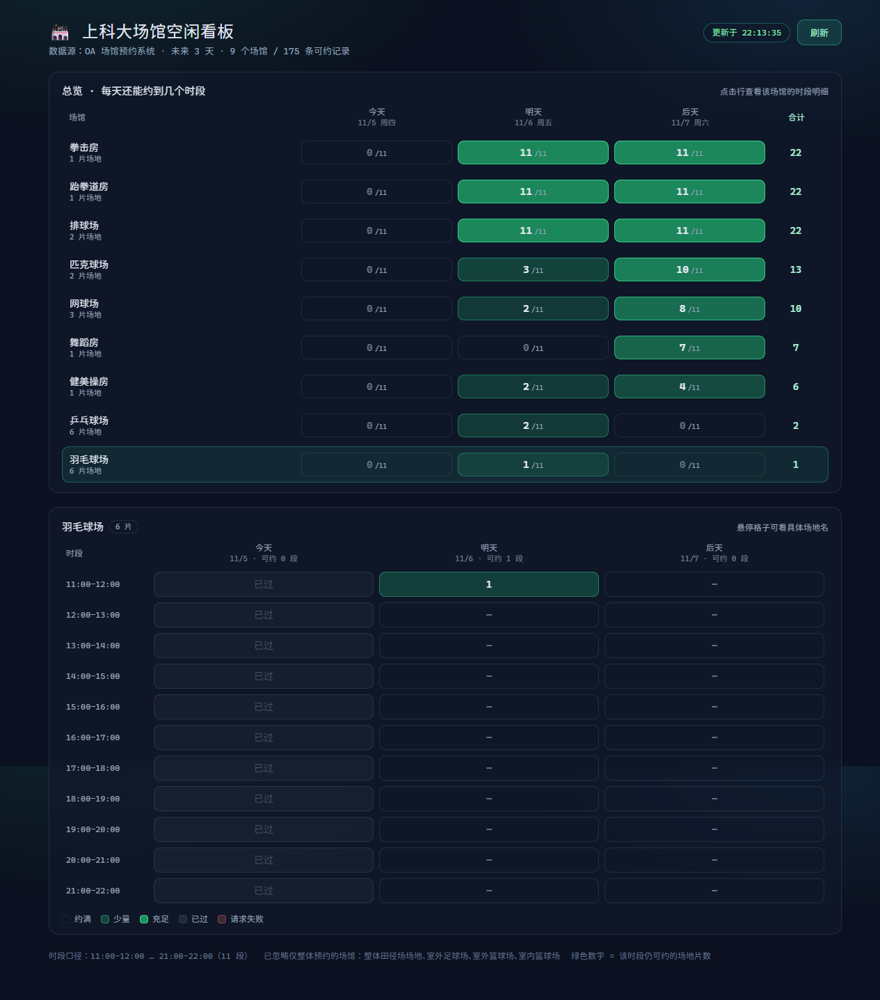

# 上科大场馆空闲看板

ShanghaiTech 体育场馆空闲查询的 **Vue 3 + Node.js** 前后端版本。业务逻辑（CAS 认证 + 泛微 OA 树形接口）与 Python 版
[`ShanghaiTech-gymBook`](../ShanghaiTech-gymBook) 完全等价，只是把「终端打印表格」换成了「网页看板 + REST API」。



## 功能

- 覆盖 OA 里 **全部 13 个场馆分类**（Python 版只查了 4 个），自动发现，不写死
- 未来 3 天 × 11 个时段（11:00–22:00）的**逐场地**可约情况，而不是简单的有/无
- 总览热力矩阵 + 单场馆时段明细，悬停可看具体场地名
- 今天已过去的时段标注「已过」，不会误判成「已约满」
- 服务端缓存快照，前端 2 秒轮询采集进度，避免重复打 OA
- 并发采集：297 次请求约 6 秒（串行约 40 秒）

## 快速开始

```bash
cd gymbook-web
cp .env.example .env      # 填 MYUSERNAME / PASSWORD（本机已填好）
npm run setup             # 安装 server 与 web 依赖

npm run dev               # 开发：API(8787) + Vite(5173)，浏览器打开 5173
```

生产模式（单端口托管前端 + API）：

```bash
npm run build             # 产出 web/dist
npm start                 # http://localhost:8787
```

> 本机 npm 配置了 `omit=dev` 且 `NODE_ENV=production`，装依赖需要 `npm install --include=dev`，
> 否则 `vite` / `concurrently` 不会装上。`npm run setup` 里已带 `--include=dev`。

## 目录结构

```
gymbook-web/
├─ server/
│  └─ src/
│     ├─ env.js        # .env 加载（必须最先执行）
│     ├─ oa.js         # CAS 登录 + AES 密码加密 + 树接口客户端（逻辑等价 Python 版）
│     ├─ service.js    # 发现分类 → 并发采集 → 快照缓存
│     └─ index.js      # Express 路由 + 静态托管
└─ web/
   └─ src/
      ├─ App.vue
      ├─ components/OverviewMatrix.vue   # 场馆 × 日期 热力矩阵
      ├─ components/VenueGrid.vue        # 时段 × 日期 明细
      ├─ api.js / time.js / styles.css
```

## API

| 方法 | 路径 | 说明 |
|---|---|---|
| GET | `/api/health` | 存活 + 采集状态 |
| GET | `/api/availability` | 快照。未就绪时返回 **202** 并自动触发一次后台采集 |
| POST | `/api/refresh` | 手动刷新（`?all=1` 连「整体预约」型场馆一起查）；采集中返回 409 |

返回结构（节选）：

```json
{
  "status": "ready",
  "progress": { "done": 297, "total": 297 },
  "data": {
    "generatedAt": "2026-11-05T14:09:11.000Z",
    "dates": ["2026-11-05", "2026-11-06", "2026-11-07"],
    "slots": ["11:00-12:00", "...", "21:00-22:00"],
    "skipped": ["整体田径场场地", "室外足球场", "室外篮球场", "室内篮球场"],
    "venues": [
      {
        "id": "63_6", "name": "室内羽毛球场", "cat": 4,
        "isParent": true, "children": 6,
        "availability": {
          "2026-11-06": { "11:00-12:00": ["羽毛球场地6号"], "12:00-13:00": [] }
        }
      }
    ]
  }
}
```

- `availability[date][slot]`：`["场地名"...]` = 可约场地；`[]` = 该时段约满；`null` = 请求失败

## 接口要点（逆向所得，Python 版同源）

```
① GET  /workflow/request/AddRequest.jsp?workflowid=14862      → 302 到 CAS
② GET  ids.shanghaitech.edu.cn/authserver/login?service=...   → 取 pwdEncryptSalt / execution / lt
③ POST 同地址（form 表单）                                     → 得到 cookie shkjdx_session
       password = base64( AES-128-CBC( key=salt, iv="Nu1L"*4, "Nu1L"*16 + 明文 ) )
④ POST /formmode/tree/treebrowser/CustomTreeBrowserAjax.jsp?id=63
        dataconditionParam=_sfn_31901_sfv_<日期>_sfn_31902_sfv_<时段1..11>_sfn_32340_sfv_<分类号>
        body: pid=<节点id>&name=
```

- `id=63` 是**树组件 ID**，不是节点；真正的根是 `63_1`
- `31901` 使用日期，`31902` 使用时间段（**恰好 11 个取值**），`32340` 场地类型
- `isParent=true` 的分类：展开分类节点 → 返回该时段仍可约的场地，空数组 = 满场
- `isParent=false` 的分类（田径场/足球场/篮球场/室内篮球）：无子场地，看它在**根层结果里是否出现**
- **条件值非法会被服务端静默忽略**（如时段传 99 就退化成「不带时段条件」）。踩坑时表现为「全空」而不是报错，
  本项目用它一次性列出全部分类

## 与 Python 版的差异

| | Python 版 | 本项目 |
|---|---|---|
| 场馆数 | 4（羽毛球/乒乓/网球/匹克球） | 13（自动发现） |
| 乒乓球分类号 | 错用 `32340=4`，结果偏少 | 修正为 `5` |
| 输出 | 终端表格 + CSV | 网页看板 + JSON API |
| 请求超时 | 2s，实测偶发失败 | 8s + 3 次重试 |
| 并行度 | 串行（~40s） | 6 并发（~6s） |
| 内网 IP 补丁 | 默认开启 | 不需要（直接走 DNS） |

## 注意事项

- 数据依赖校园网/学校 OA 可达；校外需 WebVPN。
- 采集是全量刷新（297 次请求），别在前端高频点刷新；缓存由服务端统一管理。
- `.env` 含明文密码，已在 `.gitignore` 中排除。